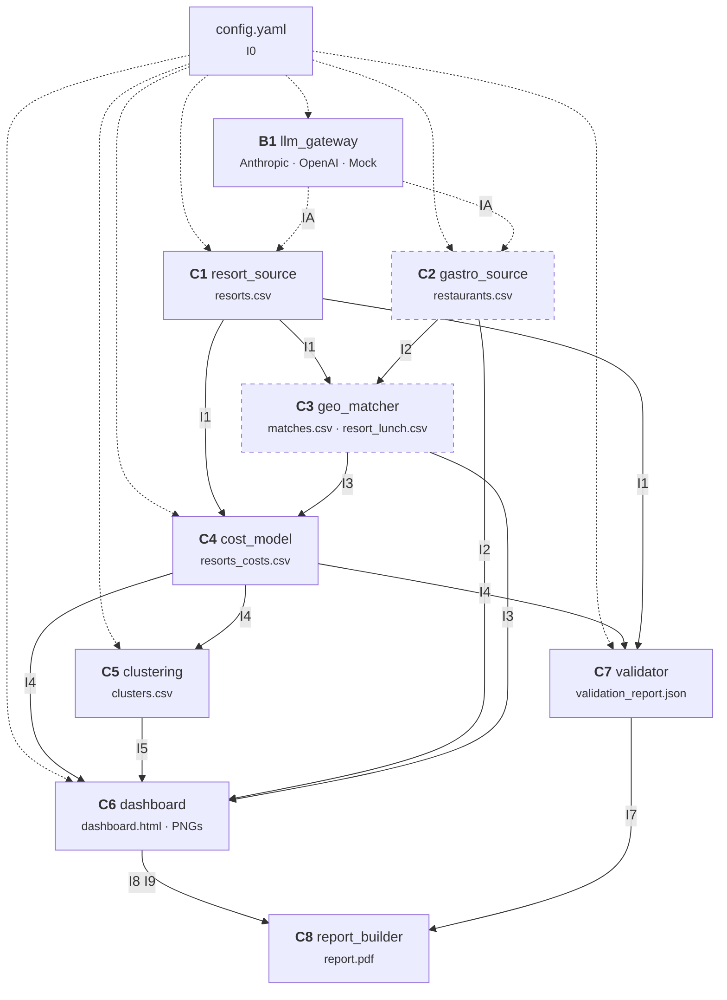

# Bestes Skigebiet für Familien – LLM-generierter Datensatz

Welches Skigebiet in den Alpen bietet einer Familie aus Singen (Hohentwiel) mit 2 Erwachsenen und 2 Kindern (16 und 13 Jahre) das beste Preis-Leistungs-Verhältnis für einen Skitag?

**[Dashboard](https://trosinde.github.io/cas_modul_2_day1_homework-bestes_skigebiet-is-available/)** · **[PDF-Bericht](report/report.pdf)**

> **Hinweis:** Die Daten wurden mit einem LLM generiert und nur stichprobenartig geprüft. Sie sind keine verlässliche Preisquelle.

## Architektur



Durchgezogene Pfeile = Dateischnittstellen (I1–I10), gestrichelte Pfeile = LLM-Aufrufe (IA). Gestrichelte Kästen kommen mit der Erweiterung ext1 (Gastronomie) dazu.

Komponenten kommunizieren nur über Dateien mit JSON-Schema-Vertrag (`contracts/`). Jede Ausgabe hat eine `.meta.json` mit Herkunftsangaben.

## Schnittstellenkatalog

| ID | Datei | Erzeuger | Nutzer |
|---|---|---|---|
| I0 | `config.yaml` | Mensch | alle |
| IA | `generate_json()` | B1 | C1, C2 |
| I1 | `data/processed/resorts.csv` | C1 | C3, C4, C7 |
| I2 | `data/processed/restaurants.csv` | C2 | C3, C6, C7 |
| I3 | `data/processed/matches.csv`, `resort_lunch.csv` | C3 | C4, C6, C7 |
| I4 | `data/processed/resorts_costs.csv` | C4 | C5, C6, C7 |
| I5 | `data/processed/clusters.csv` | C5 | C6 |
| I6 | `task5_validation/fact_check_sample.csv` | C7 / Mensch | C7 |
| I7 | `task5_validation/output/validation_report.json` | C7 | C8 |
| I8 | `report/figures/*.png` | C6, C7 | C8 |
| I9 | `task4_visual_exploration/output/dashboard.html` | C6 | C8, GitHub Pages |
| I10 | `data/processed/*_merge_log.csv` | C1, C2 | C7 |

## Setup

```bash
python3 -m venv .venv
source .venv/bin/activate
pip install -r requirements.txt
```

### LLM-Anbieter konfigurieren

Genau **einen** API-Key in `.env` setzen:

```bash
cp .env.example .env
# Dann ANTHROPIC_API_KEY oder OPENAI_API_KEY eintragen
```

Für Entwicklung ohne Kosten: `provider: mock` in `config.yaml` setzen.

## Aufruf

```bash
# Gesamte Pipeline mit Mock-LLM (kostenlos, Beispieldaten)
make mock-all

# Gesamte Pipeline mit echtem LLM
make all

# Einzelne Komponenten
make resorts          # C1: Skigebietsdaten holen
make gastro           # C2: Restaurantdaten holen (ext1)
make match            # C3: Geo-Zuordnung (ext1)
make costs            # C4: Kostenmodell
make cluster          # C5: Clustering
make dashboard        # C6: Dashboard erzeugen
make sample           # C7: Faktencheck-Stichprobe
make validate         # C7: Validierung durchführen
make report           # C8: Bericht bauen

# Testbatch (1 Batch, zur Kontrolle vor dem vollen Lauf)
make resorts-test
make gastro-test

# Speisekarten-Scraping (Playwright + LLM, per Default deaktiviert)
make gastro-scrape                    # alle Restaurants mit Website
make gastro-scrape MENU_LIMIT=20      # nur 20 Speisekarten
```

### Speisekarten-Scraping aktivieren

Per Default nutzt C2 nur Länderdurchschnitte (Eurostat) für die Mittagspreise. Um echte Speisekarten zu lesen (Playwright + LLM), gibt es drei Wege:

1. **Make-Target:** `make gastro-scrape`
2. **CLI-Flag:** `python -m components.gastro_source --scrape-menus`
3. **Config:** In `config.yaml` unter `gastro:` setzen: `scrape_menus: true`

Das Scraping ist **inkrementell** — bei Abbruch und Neustart werden bereits erfolgreich extrahierte Restaurants aus dem Cache geladen (kein erneuter LLM-Aufruf).

## Tests

```bash
make test               # alle Tests
make test-contracts     # Schemas gegen Beispieldaten prüfen
make test-cost-model    # einzelne Komponente testen
```

## Verzeichnisstruktur

```
├── config.yaml                  Konfiguration (I0)
├── contracts/                   JSON-Schemas + Beispieldaten
│   ├── *.schema.json
│   └── examples/                5 Skigebiete, 10 Restaurants, Mock-LLM
├── prompts/                     LLM-Prompt-Templates
├── common/                      Geteilte Utilities
├── components/
│   ├── llm_gateway/             B1: LLM-Zugang
│   ├── resort_source/           C1: Skigebietsdaten
│   ├── gastro_source/           C2: Restaurantdaten (ext1)
│   ├── geo_matcher/             C3: Koordinaten-Zuordnung (ext1)
│   ├── cost_model/              C4: Kostenmodell
│   ├── clustering/              C5: k-Means + PCA
│   ├── dashboard/               C6: HTML-Dashboard
│   ├── validator/               C7: Validierung
│   └── report_builder/          C8: PDF-Bericht
├── pipeline/                    Orchestrierung
├── data/                        Roh- und Verarbeitungsdaten
├── task1–6_*/                   Texte für den Bericht
├── report/                      Bericht + Grafiken
└── docs/                        GitHub Pages (Dashboard)
```

## Lizenzen

- **Code:** MIT
- **Daten:** CC BY 4.0

Written Assignment «LLM-Based Dataset Creation and Validation», CAS Generative AI, Universität Zürich.

**Autor:** Thorsten Rosin, mit Unterstützung von Claude (Anthropic)
